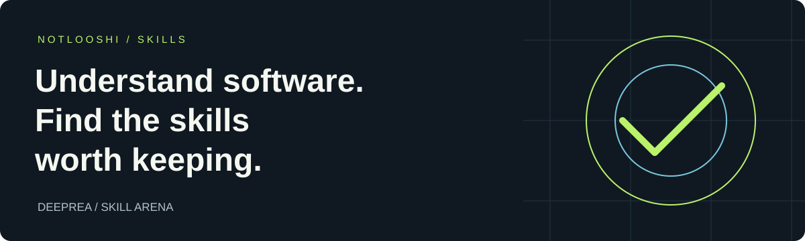

<p align="center"></p>

<h1 align="center">Give your agent a better way to work.</h1>
<p align="center">Understand the software you study.<br>Find the skills worth keeping.</p>
<p align="center"><a href="#choose-your-skill">Explore the skills</a> · <a href="#get-started">Get started</a> · <a href="#evidence-you-can-inspect">Inspect the evidence</a></p>

---

## Choose your skill

Two focused skills for two different jobs. Start with the one that solves your next problem; each can be used independently.

- **[Skill Arena](docs/skill-arena.md)** — Compare your skills on real work and find the ones worth keeping.
- **[DeepREA](docs/deeprea.md)** — Investigate shipped software and check a reconstruction against the original.

### Skill Arena · Put your skills to the test

Several skills promise the same thing. Which ones earn their place? Skill Arena groups them by job, discovers challengers, and compares actual outputs. You get scoped keep, replace, or defer decisions, with saved comparison history. Cleanup includes a verified backup and recovery information.

Start with a read-only audit:

```text
Use $skill-arena to group my skills by job and identify overlap.
Audit only: do not download, benchmark or change anything.
```

**[Explore Skill Arena →](docs/skill-arena.md)**

### DeepREA · From shipped software to understood behavior

Start with an application, binary, package, or recorded runtime evidence. DeepREA guides the investigation around the behavior you need to recover, preserves what was observed, and helps check a reconstruction against the original. It bundles REA specialist guidance with additional investigation and verification procedures.

```text
Use $deeprea to investigate this supplied application.
Explain how its export feature works, show the supporting evidence,
and identify what remains unknown. Stay within the supplied workspace.
```

**[Explore DeepREA →](docs/deeprea.md)**

## Get started

Review the skill's files, then install its complete folder through your host's supported skill mechanism. In Codex, ask its skill installer:

```text
Install the skill-arena folder from https://github.com/NotLooshi/skills.
Preserve any existing version so I can roll back.
```

Replace `skill-arena` with `deeprea` to choose another skill. Refresh discovery using your host's supported mechanism, confirm the skill is available, and try its example above.

Installing a skill adds instructions and bundled resources. Execution tools remain host-dependent: DeepREA does not install REA or analysis engines, and Skill Arena needs suitable tools to run comparisons. See each project page for prerequisites and recovery steps.

## Evidence you can inspect

**[Skill Arena](skill-arena/EVALUATION.md):** internal output comparisons, catalog checks, and interrupted-recovery execution. General performance gains and operation on every host remain unverified.

**[DeepREA](EVALUATION.md):** on one Windows application, 46/46 known regression cases passed versus REA's 38/46; both tied on 20 new exact cases. One run per condition, a development-known target, and a disclosed scope deviation limit the result. This does not establish general superiority.

The project pages keep the details close to their claims. DeepREA's public records support rechecking grades; they do not provide a complete rerun of the original agent investigations.

## Source and licenses

Read the instructions before installing: [Skill Arena](skill-arena/SKILL.md), [DeepREA](deeprea/SKILL.md).

[Skill Arena](skill-arena/LICENSE) includes its own MIT license. DeepREA is an independent adaptation of REA; see the repository [license](LICENSE) and [attribution](ATTRIBUTION.md) for its retained upstream material.

Also in this repository: [Cerebellum](cerebellum/README.md), a standalone agent operating prompt.
