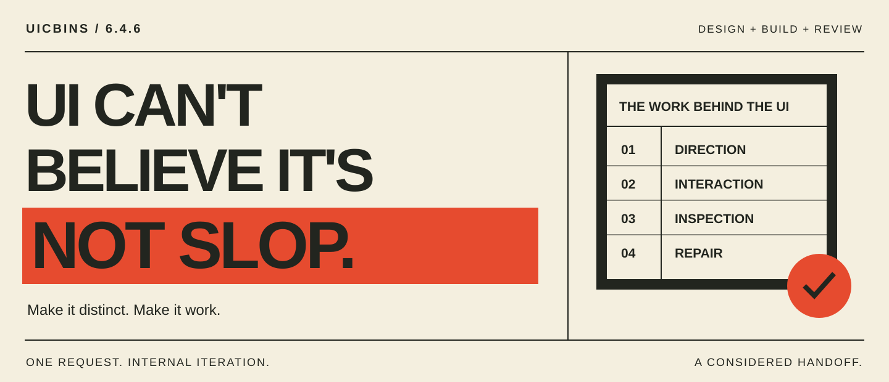

<p align="center">
  
</p>

<h1 align="center">UI Can't Believe It's Not Slop</h1>

<p align="center"><strong>Give your interface a point of view.<br>Then make every interaction earn its place.</strong></p>

<p align="center">A standalone design-and-build skill for coding agents.<br>Art direction, complete interactions, browser inspection, review and repair.</p>

<p align="center"><a href="#install-from-this-repository">Install</a> · <a href="#try-it">Try it</a> · <a href="#top-tier-design-tested-beyond-screenshots">Results</a> · <a href="../../skills/uicbins/SKILL.md">Read the skill</a></p>

---

## A first draft is a starting point.

A page can look finished while the form forgets your edits, the phone layout clips a heading, or keyboard focus disappears. UICBINS asks your agent to carry the work through those details: choose a visual direction, build a complete slice, inspect it in the browser, challenge the result, and repair what fails.

**One request. Internal iteration. One considered handoff.** “One-shot” means one user handoff after planning, building, checks and review—not accepting the first generated page.

Use it for landing pages, product interfaces, dashboards, redesigns and motion polish. Bring a brief, an existing project, or a reference website URL. The standalone release includes the full workflow; Pro is optional additional guidance, not a feature unlock.

## Design with intent. Verify the details.

| Work | What UICBINS brings |
| --- | --- |
| **Choose a direction** | A concrete approach to type, colour, composition, imagery and purposeful motion, grounded in your brief. |
| **Build the journey** | Components and interactions planned through valid, invalid, edit, cancel and post-success states. |
| **Inspect the result** | Browser checks for rendered text, overflow, focus, forms, motion and relevant accessibility concerns. |
| **Challenge and repair** | Adversarial review, scoped fixes and final checks against the delivered files. |

The package includes a direction library, reference guides and runnable inspection helpers. It guides the agent's process; actual execution depends on the tools available in your host.

## Bring a reference. Keep your identity.

Supply a live website URL and a clear brief. UICBINS inspects the reference's layout, hierarchy, typography and interaction patterns, then adapts the relevant ideas to your content and brand.

The URL module needs an accessible website; a screenshot alone does not activate it. It reports inaccessible references as a limitation. Reference inspection does not grant permission to reuse another site's branding or assets.

## Top-tier design. Tested beyond screenshots.

In our five-skill comparison, an anonymous visual review placed **UICBINS alongside Impeccable and Emil in the top tier**, ahead of Stitch and Taste on the tested brief. The reviewer highlighted UICBINS's visual identity and offer comparison.

| Trial | Observed result |
|---|---|
| Five-skill visual comparison | Joint top tier on the tested landing-page brief |
| Separate UICBINS landing-page repeat | **27/27 checks passed** after internal review and repairs |
| Fieldnotes reading-list app with live URL adaptation | **25/25 checks passed** after review and repairs, including coordinator QA |

The competitive trial used the same brief, fresh contexts and **GPT-5.6-Terra at medium effort**. Each skill could use its normal internal workflow; time and token budgets were not fixed. Stitch means its design guidance, not the hosted service.

These are separate results, not a combined win rate. All five original outputs passed the mechanical checks, and all still had review findings; UICBINS's first output had unsupported timing copy and mobile text over artwork. The visual ranking comes from one review of one sample per skill. The repaired repeat does not inherit that ranking, and no conversion uplift was measured. [Read the methodology, findings and limitations](EVALUATION.md).

## Install from this repository

For a project-local Codex installation, copy the complete `skills/uicbins` folder to `<your-project>/.agents/skills/uicbins`, then start a new task in that project and invoke `$uicbins`. This route was exercised with a clean extraction and an explicit PLAN invocation in the local Codex CLI. The invocation loaded the expected package version and left the project unchanged.

Preserve every bundled folder, including `references/`, `scripts/` and `toolkit/`, plus `LICENSE` and all notices. Copying only `SKILL.md` omits required resources. Preserve any existing `uicbins` folder before replacing it.

For a personal installation, Codex also uses `$CODEX_HOME/skills` (normally `~/.codex/skills`); the release evaluation tested the project-local route above. The source folder is [skills/uicbins](../../skills/uicbins) in this repository. Other skill-capable hosts may support this format, but their discovery and execution have not been verified here.

## Try it

### Build something distinctive

```text
Use $uicbins to build a responsive landing page for my studio.
Our primary action is requesting a consultation. Use the supplied copy.
Choose a coherent visual direction and carry it through the full page.
Keep booking a clearly labelled local demo until I supply an endpoint.
Check phone and desktop layouts, keyboard access and reduced motion.
```

### Adapt a website to your product

```text
Use $uicbins to adapt https://example.com to the attached product brief.
Inspect its hierarchy, typography and interaction patterns.
Keep our content and brand; do not copy its claims or assets.
Build and check the main user journey, including edit and error states.
```

Replace the example URL with your actual reference.

### Refine an existing interface

```text
Use $uicbins to refine this interface.
Preserve the accepted brand direction and existing functionality.
Inspect the rendered result, identify the highest-impact visual and
interaction problems, repair them, and rerun the affected checks.
```

### Get a review without edits

```text
Use $uicbins in REVIEW mode on this interface.
Check composition, content truth, responsive layout and the main journey.
Report observed problems and concrete closure checks. Do not edit files.
```

For direction before implementation, request **PLAN** mode. It ends with a buildable direction; **BUILD** includes repairs, **REFINE** revisits the affected decisions, and **REVIEW** reports without editing.

## Requirements and boundaries

The host must provide file editing, Node.js for the bundled check scripts (tested with 24.14.0), and a working Chromium/browser automation route to complete implementation and rendered QA. Use an existing compatible environment; the package does not install these dependencies. The bundled inspector also needs a working Chromium executable (the tested Windows environment supplies it through `CHROME_PATH`). A host with delegated review can run the fresh adversarial reviewer; otherwise the agent must label its challenge as same-agent review. The skill installs no tools and bundles no protected controller. Without the needed tools, the agent should report partial verification. It should preserve project constraints and avoid inventing product facts, customer proof, pricing or backend behaviour.

For commercial pages, it recommends discoverable cost information and asks about undecided pricing treatment. It respects intentional omission; pricing and sales CTAs are not universal requirements for every page.

## Evaluation

Release validation checks package structure separately from generated-site behaviour. A small sample cannot establish universal design quality, accessibility conformance, conversion uplift or superiority over other libraries. Consult [the evaluation summary](EVALUATION.md) for the tested version, model, tasks and unresolved limitations.

## Licence and attribution

Original material: [MIT](../../skills/uicbins/LICENSE), copyright 2026 Ledio Zefi. Preserve the included [attribution](../../skills/uicbins/NOTICE.md) and [third-party notices](../../skills/uicbins/THIRD-PARTY-NOTICES.md). Third-party assets and runtime libraries retain their own terms. UICBINS-Pro is a separate package and is not included in this standalone distribution.

---

**Make the direction deliberate. Make the result usable.**

[Install UICBINS](#install-from-this-repository) · [Read the source](../../skills/uicbins/SKILL.md) · [Explore the collection](../../README.md)
